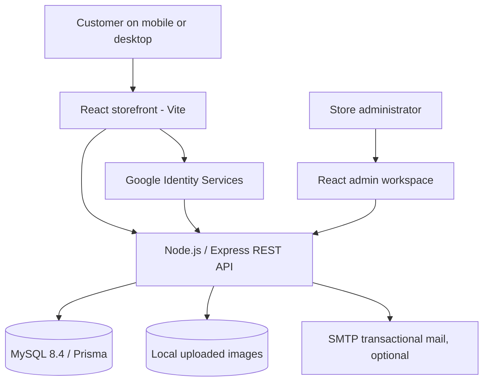

# SL Options Market

A **mobile-first Sri Lankan e-commerce starter platform** built for the **SL Options** product family. It has a React storefront, React administration workspace, Express/Node.js REST API, MySQL + Prisma database, and a deliberately compact domain model.

> **Important:** This is an implementation-ready starter, not a verified production launch. Install dependencies, configure Google and SMTP, test against MySQL, replace sample products and legal copy, and complete the production security checklist before taking real orders.

## What's included

| Customer experience | Staff / admin experience |
| --- | --- |
| Editorial home, categories, live search, sorting, product details | Protected dashboard with metrics and recent orders |
| Cart (guest cart + sign-in sync), quantity controls, stock checks | Create/edit/archive products, set prices, stock, featured flag |
| Wishlist associated with account | Manage categories and catalogue visibility |
| Email/password registration and login | View customer accounts |
| Google sign-in and authenticated Google account linking | View orders and change fulfilment/payment status |
| Password recovery by expiring email link (SMTP required) | Upload product images (JPEG/PNG/WebP) |
| Saved delivery addresses, account settings, purchases | Edit store name, announcement, delivery fees and support email |
| Sri Lankan addresses: districts, LKR and islandwide flat/free delivery | Optional order email alerts (SMTP required) |
| Secure cookie sessions; checkout order and stock transaction | Responsive, light modern workspace |

### Design

Visual direction: soft ivory background, deep evergreen, pale citrus highlights, bold editorial headings and calm product photography/illustrations. All demo product images are local **illustrations**, not verified photos of items for sale. Replace them in the admin before launch.

### Payment gateway decision

**Physical products cannot be processed using Paddle.** Paddle's acceptable-use policy explicitly lists physical products and products requiring delivery as prohibited. This starter enables **cash on delivery** and tracks payment manually in admin. For card payments, integrate an approved Sri Lankan e-commerce merchant gateway such as **PayHere** or **OnePay** after merchant onboarding. Never mark an order as paid from a browser redirect; a future online gateway must verify a signed server-to-server callback/webhook and use idempotency.

References:
- Paddle acceptable use: https://www.paddle.com/help/start/intro-to-paddle/what-am-i-not-allowed-to-sell-on-paddle
- Google ID-token verification: https://developers.google.com/identity/gsi/web/guides/verify-google-id-token
- PayHere: https://support.payhere.lk/general-questions
- OnePay: https://www.onepay.lk/solutions/online-payments

## Architecture



One React application serves both `/` and `/admin`. The API guards all `/api/admin/*` routes by the database ADMIN role; there is no public admin registration route.

### Project structure

```
sl-options-market/
  apps/
    web/             React 19 + Vite; responsive storefront and admin
      src/
      public/demo/   Demo product SVG illustrations
    api/             Express API and authentication
      src/
      prisma/        MySQL data schema, initial migration, seed
      tests/         Pure logic tests
  docker-compose.yml Local MySQL container
  package.json       npm workspaces
```

## WAMP Server setup (Windows, without Docker)

Start WAMP MySQL, then create an empty `slstore` database in phpMyAdmin using `utf8mb4`. WAMP Apache is not needed for React/Node.js development. The initial migration now explicitly uses InnoDB to enforce foreign keys, and 64-character IDs to stay within shorter index limits.

From the repository root in PowerShell:

```powershell
Copy-Item apps/api/.env.example apps/api/.env
Copy-Item apps/web/.env.example apps/web/.env
# Edit apps/api/.env: DATABASE_URL, ADMIN_EMAIL, ADMIN_PASSWORD, etc.
# Example when the WAMP root account has no password (local development only):
# DATABASE_URL="mysql://root@127.0.0.1:3306/slstore"
npm install
npm run db:generate
npm run db:deploy
npm run db:seed
npm run dev
```

Use your actual WAMP MySQL port and login; percent-encode special characters in a password included in the database URL. A dedicated database user is recommended beyond local development.

### Initial failed migration: P3018 / MySQL 1071

The previous initial migration indexed two `VARCHAR(191)` foreign-key columns together, exceeding a 1,000-byte index cap under `utf8mb4`. After pulling the corrected files, **only if this is a new/disposable `slstore` database with no data worth keeping**, run:

```powershell
git pull origin main
# DANGER: Permanently deletes all data and tables in the slstore database.
npm exec -w apps/api -- prisma migrate reset --force
npm run db:generate
npm run db:seed
npm run dev
```

Do not run `migrate reset` against a database containing valuable data. Back it up and inspect the `_prisma_migrations` table plus partially created tables first; use a non-destructive recovery plan instead. This initial migration was amended only because the reported deployment failed before the application had been initialized.

## Local setup (Node 22 and npm 10+)

1. Install Node.js 22+, npm, and MySQL 8.4 (or Docker with Compose).
2. Clone/extract the project.
3. Start local MySQL:

```bash
# From the repository root
docker compose up -d mysql
```

The example Docker configuration binds MySQL to **127.0.0.1:3308**, so it does not collide with an existing MySQL on port 3306. The included database credentials are for **local development only**; change them for any shared or live environment.

4. Configure environment and install dependencies:

```bash
cp apps/api/.env.example apps/api/.env
cp apps/web/.env.example apps/web/.env
npm install
npm run db:generate
npm run db:deploy
npm run db:seed
```

For Windows PowerShell, use `Copy-Item` instead of `cp` as needed.

5. Start both apps:

```bash
npm run dev
```

- Storefront: http://localhost:5180
- Admin: http://localhost:5180/admin
- API health: http://localhost:4010/api/health

**Development seed:** `ADMIN_EMAIL=admin@example.com` and `ADMIN_PASSWORD=ChangeMeAdminPassword123!` are placeholder settings in `apps/api/.env.example`. Replace them with an email you control and a strong unique password *before running the seed*, then sign in at `/login` and visit `/admin`. The seed never overwrites an existing admin password and will not promote an existing customer automatically. The seeded eight items are labeled demo products.

If you already use a local MySQL installation, create a database and user, then point `DATABASE_URL` in `apps/api/.env` to it. You can skip Docker.

**Frontend development port:** Vite runs on `http://localhost:5180`. If `apps/api/.env` already exists on your machine, update `WEB_ORIGIN=http://localhost:5180` and `STORE_URL=http://localhost:5180` yourself; `.env` files are intentionally not committed. Register `http://localhost:5180` as an authorized JavaScript origin in Google Cloud for Google sign-in. Restart both development servers after changing environment settings.

## Configure Google sign-in

Create a **Web application OAuth Client ID** in Google Cloud (OAuth consent screen and Google Identity Services). During local development add `http://localhost:5180` to the client's **Authorized JavaScript origins**. In production add the HTTPS storefront origin.

Set the **same** client ID in:

- `apps/api/.env` as `GOOGLE_CLIENT_ID`
- `apps/web/.env` as `VITE_GOOGLE_CLIENT_ID`

Restart the API and Vite after editing environment values. The React Google button receives a Google ID token; the backend validates signature, expiry, issuer and configured audience with `google-auth-library` and persists the stable Google `sub`. An existing email/password account must be signed into first before attaching Google in Account > Settings. There is no unsafe automatic linking by email alone.

## Configure password recovery and order emails

Set these in `apps/api/.env` using an SMTP account approved for transactional mail:

```dotenv
STORE_URL=http://localhost:5180
SMTP_HOST=smtp.example.com
SMTP_PORT=587
SMTP_USER=mailer@example.com
SMTP_PASSWORD=<set-a-private-smtp-password>
SMTP_FROM="SL Options Market <mailer@example.com>"
ORDER_ALERT_EMAIL=<your-inbox>
```

Without SMTP, checkout and order management work but emails are **not sent**, and password recovery returns a configuration message. Configure an SMTP sender before selling to customers. Password reset tokens are stored hashed, expire after 30 minutes and are single-use. Order confirmation mail is best-effort; the order transaction succeeds independently from mail delivery.

## How to use the platform

1. Sign in with the admin credentials you seeded and visit `/admin`.
2. Add/edit categories and products. Product prices in admin are shown in **LKR**, and stored in **cents** (`priceCents`) internally.
3. Upload real photos and change each product to **ACTIVE** to list it on the customer store. Use **DRAFT** to hide products.
4. Configure delivery pricing in Admin > Store settings. The default is **Rs. 450 flat** and **free delivery from Rs. 15,000**, both examples and adjustable.
5. Customer browses, adds to cart, signs in/creates account, adds delivery address and confirms cash-on-delivery order.
6. Admin reviews and fulfils the order in Admin > Orders. Changing an order to CANCELLED returns reserved stock; cancelled orders cannot be reopened. **PAID** should only be selected when payment has genuinely been collected.

## Store information pages and responsive navigation

This batch adds the public pages:

- `/contact` — customer contact form and store support links.
- `/shipping-returns` — delivery charges, COD, order tracking, and return contact procedure.
- `/privacy` — customer account/order data use, cookies, retention and enquiries.
- `/terms` — store/account, prices, orders and shopping terms.
- `/policies` — index linking to all four pages for backward compatibility.

**Contact email setup:** the Contact form posts to `POST /api/contact`, with Zod field validation, an IP-based limit of five requests per fifteen minutes and a hidden honeypot. It forwards valid enquiries as plain-text email using the SMTP settings already described above. Set `SMTP_HOST`, `SMTP_PORT`, `SMTP_USER`, `SMTP_PASSWORD` and `SMTP_FROM`. The destination defaults to `CONTACT_ALERT_EMAIL`, then `ORDER_ALERT_EMAIL`, then the editable `StoreSettings.contactEmail`. Only the store receives the message. If SMTP is not configured, the API returns a clear 503 error and the page provides a direct email link. No contact-message database table was added.

Example optional environment configuration:

```dotenv
CONTACT_ALERT_EMAIL=your-store-inbox@example.com
```

Do not use an unverified placeholder inbox before launch. The default store email in the seed data is a sample; set the real merchant support email from Admin → Store settings.

**Legal and policy review:** these pages are carefully scoped drafts for this Sri Lankan single-merchant store, not a substitute for professional review. Confirm merchant legal identity/contact information, actual courier/service restrictions, shipping turnaround, returns eligibility and window, product-specific warranties, and refund arrangements before accepting public orders. Preserve consumer rights and ensure the published terms match operations. Sri Lanka's Consumer Affairs Authority online commerce direction (Gazette dated 17 May 2023) requires transparent business information, order/delivery information and privacy safeguards. The Personal Data Protection Act No. 9 of 2022 was amended in 2025 and its operation is phased according to gazette orders; check current DPA guidance before launch.

Useful official sources:
- https://caa.gov.lk/web/images/Direction/English/sec10/91_E.pdf
- https://www.dpa.gov.lk/notice.php
- https://www.dpa.gov.lk/guidelines.php

**Navigation fix:** a route-aware ScrollManager opens new pages at the top and preserves anchor targets. The themed dropdown component now scrolls its list internally rather than invoking global `scrollIntoView`. Account, wishlist and cart previews use a viewport portal; they center under the sticky top bar on tablets/phones and remain fully scrollable. The account, orders, forms, invoices, contact and policy layouts are responsive.

Run `npm test`, `npm run build`, `npm audit`, `npm run dev` and the browser checks in `QA_CHECKLIST.md` on port 5180. **No database migration or reset is required for this batch.**

## Frontend loading animation

The React storefront has an SL Options Market branded **first-paint preloader**. The initial HTML displays the animated emblem, text and indeterminate progress accent before the React bundle starts; `AppPreloader.jsx` renders the matching overlay during initial account/session restoration. It fades out automatically as soon as the store is ready — there is no artificial minimum loading duration. A nine-second safety timeout prevents indefinitely blocking the interface if initial network requests stall.

The animation uses lightweight CSS only (no image downloads or animation libraries). It respects `prefers-reduced-motion: reduce`. Existing async page `Spinner` components now use a matching small brand emblem, without showing the full-screen preloader during every route change.

Files: `apps/web/src/preloader.css`, `AppPreloader.jsx`, `index.html`, `App.jsx` and `components.jsx`. There are no database or backend changes.

From the feature branch, run `npm ci`, `npm test`, `npm run build` and `npm run dev`; verify initial loads and slow-network behaviour at `http://localhost:5180`, plus the preloader checklist in `QA_CHECKLIST.md`.

## Customer and product analytics

A privacy-aware first-party analytics dashboard is available at **Admin → Analytics**, with 7/30/90-day item views, clicks, wishlist/cart signals, checkout entries, non-cancelled orders and COD receipts, customer-item interest drilldowns, CSV export, and an overview shortcut. It uses the additive `ProductEvent` MySQL migration and requires no analytics SaaS. See [ANALYTICS_REPORTING.md](ANALYTICS_REPORTING.md) for data definitions, user privacy controls, 90-day retention and WAMP migration/testing steps. The root `predev` hook runs Prisma generation automatically before development servers start.

## Production deployment notes

Run the backend and built frontend under the **same HTTPS origin** if possible:

```bash
npm run build
# Configure NODE_ENV=production, WEB_ORIGIN=https://your-store-domain,
# STORE_URL=https://your-store-domain, DATABASE_URL, and secure SMTP.
npm run db:deploy
npm run start
```

The Express API serves the prebuilt `apps/web/dist` files alongside `/api` and `/uploads`. Put the Node server behind Nginx, Caddy or another trusted HTTPS reverse proxy; configure `TRUST_PROXY=true` **only** when your reverse proxy is trusted and forwards client IPs correctly. Do not expose Node or MySQL ports publicly. Persist and back up `apps/api/uploads` and MySQL. Configure a process manager or container health checks.

Production checklist before launch:

- Confirm migration success, seed only approved admin accounts, rotate all example credentials.
- Verify Google OAuth origins, `WEB_ORIGIN`, same-origin HTTPS, secure cookies and login/logout flows.
- Configure SMTP and verify reset, confirmation and store notification emails.
- Replace demo listings, price/stock figures, photos, brand copy, and placeholder support address.
- Write and review real privacy notice, terms, returns/refunds, shipping timelines, contact page, and applicable Sri Lankan tax/consumer obligations.
- Perform payment-gateway merchant onboarding before enabling cards or LankaQR; COD works now.
- Test stock conflicts, multiple simultaneous checkouts, cancellations, order status updates and rate limits against MySQL.
- Implement monitoring, backups, restore drills, admin MFA, operational audit log and stronger abuse controls before accepting meaningful production traffic.
- Evaluate hosted object storage (S3/Lightsail Object Storage) for product photos if you scale to multiple backend instances.
- Review CSP with your final Google sign-in and image domains; limit approved product image domains.

## Tests and status

```bash
npm test
npm run build
```

6 utility tests cover slug generation, delivery threshold, public user data filtering and token/order identifier properties. Additional integration and end-to-end tests require dependencies and a running MySQL instance. The code in this archive was statically checked for JavaScript/JSX/CSS syntax and utility tests were run. **Dependency installation, Prisma schema validation, Vite production build and full API/UI flows were not executed in the generation environment because npm registry DNS was unavailable.** Run the installation, build and MySQL checkout test sequence on your machine before launching.

## What this intentionally avoids

No marketplace sellers, complex warehouse network, customer loyalty points, subscriptions, or multi-currency conversions. The first release is a **single-merchant Sri Lankan store** with clear customer and admin workflows.
